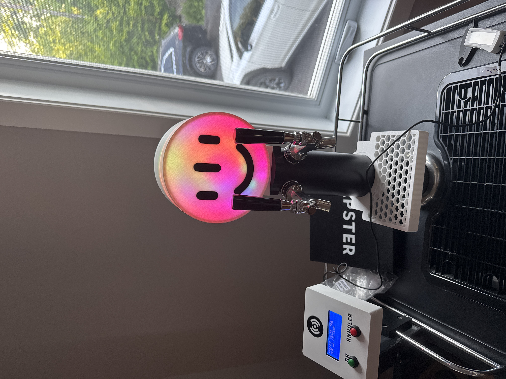
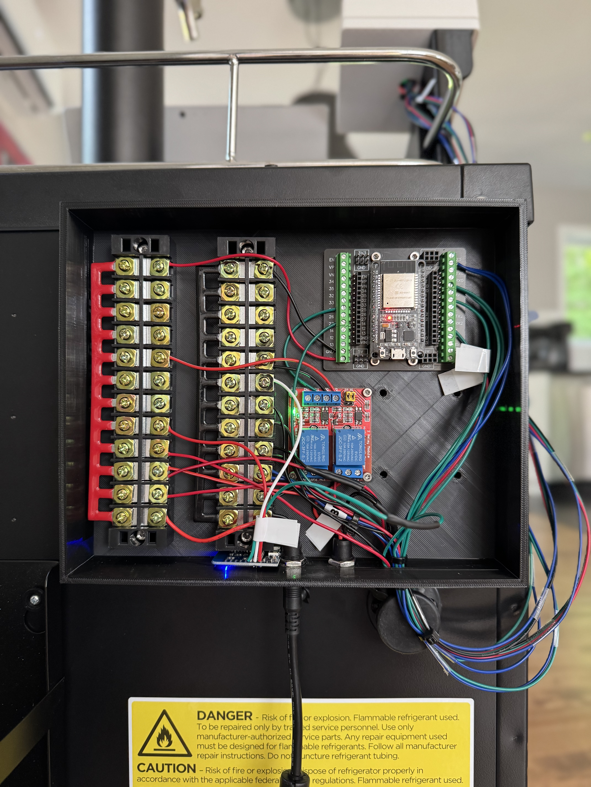
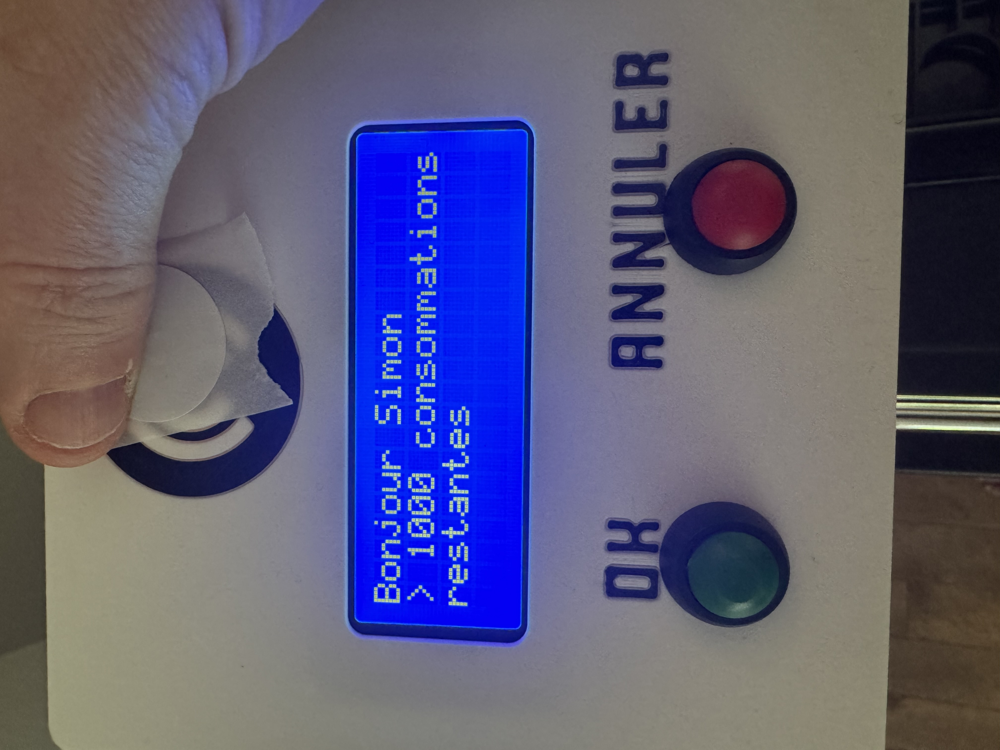
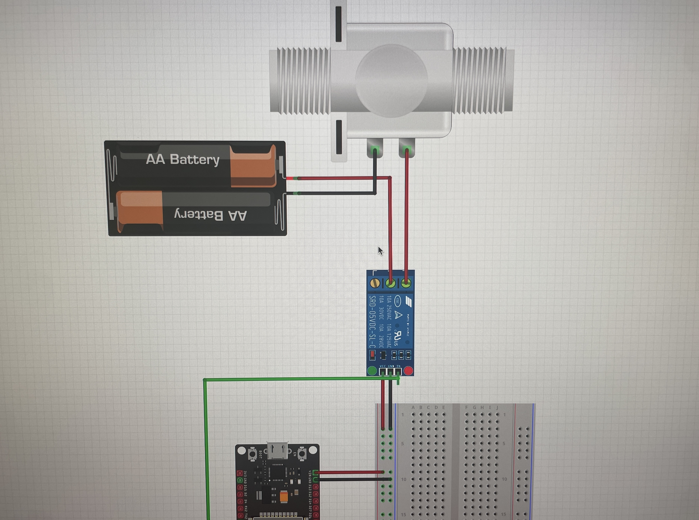

# 🍷🍺 SmartTap — Automated Beverage Dispensing System

> A full-stack IoT system built for real-world event deployment, combining NFC authentication, cloud-connected user management, real-time flow control, and a live web dashboard — all running on an ESP32.

---

## 📖 System Overview

SmartTap is an automated beverage dispenser designed for events. Users tap their NFC wristband or card to authenticate, choose their drink (wine or beer), and receive a precisely measured pour — all tracked in Firebase, logged to an SD card, and controllable from a web interface.

---

## 📷 Photos & Videos

| Full System (WLED active) | Wiring |
|---|---|
|  |  |

| NFC Scan | Flow Meter Wiring Diagram |
|---|---|
|  |  |

### 🎥 Videos
- [NFC Scan — UI response as user taps tag](photos/nfc_scan_vid.mov)
- [Pour Progress — percentage tracking in real time](photos/pour_%25_vid.mov)

---

## 🙋 What I Personally Built

This was a fully solo engineering project — I independently designed, built, wired, programmed, and deployed the entire system. The client provided only the functional requirements and real-world use case; all hardware design, firmware, backend systems, and integration work were completed by me.

- **Embedded firmware (ESP32)** — Developed the complete `main.ino` system, including NFC authentication via PN532, Firebase Realtime Database integration, flow meter pulse counting and calibration, pump and valve control through GPIO relays, FreeRTOS task scheduling, watchdog timer fault recovery, SD card logging, NTP time synchronization, and a full asynchronous web server hosting the admin interface
- **Cloud backend (Firebase)** — Designed the entire database architecture for users, coupon balances, pour logs, calibration values, and system configuration. Implemented all real-time read/write operations between the ESP32 and Firebase
- **Embedded web interface** — Built a full admin dashboard served directly from the ESP32 using dynamically generated HTML, CSS, and JavaScript. Includes user management, pour history, flow meter calibration, device configuration, WiFi setup, and manual hardware control
- **Python real-time dashboard** — Developed a TCP-based communication bridge between the ESP32 and a Python backend. Built a Flask web application for live system monitoring and wrapped it as a desktop application using PyWebView
- **Hardware design** — Selected all components and designed the full electrical system, including relay-controlled pump and solenoid circuits, dual flow sensor setup, NFC reader, LCD interface, DFPlayer audio module, and WLED lighting for state-based visual feedback
- **Deployment** — Delivered as a fully functional IoT system for a real paying client for use at live events

---

## 📈 Impact

- Deployed for real event use via a paying client
- Automated beverage dispensing with real-time tracking and NFC-based authentication
- Eliminated manual drink tracking and reduced misuse through per-user coupon enforcement
- Enabled full remote system management through cloud backend and embedded web interface

---

## 🧠 Engineering Highlights

- Real-time embedded state machine architecture running on bare metal ESP32
- Multi-threaded system using FreeRTOS with dual-core task pinning
- Full IoT stack: hardware → firmware → cloud → UI, built and integrated entirely from scratch
- Hybrid communication system combining WiFi, TCP sockets, HTTP, and Firebase RTDB
- Designed for real-world reliability in live event environments with watchdog fault recovery and local SD card fallback logging

---

## ✨ Features

### 🔐 NFC Authentication
- PN532 module reads NFC UIDs and matches them to Firebase user profiles
- Each user has a name, phone number, account status, and per-drink coupon balance
- Unauthorized or depleted-coupon users are denied service

### 🍷🍺 Dual Dispensing Control
- **Tap 1 (Beer):** Solenoid valve + pump controlled via GPIO
- **Tap 2 (Wine):** Independent pump + valve on separate GPIO pins
- Each dispenser calibrated to a configurable pour volume (default: 250 mL)
- Real-time flow measurement via pulse-counting sensors on GPIO 26 & 27

### 📊 Firebase Cloud Backend
- User profiles: first/last name, UID, phone, coupon balances, usage history
- Pour logs: timestamp, drink type, volume, and user identity
- All data readable and editable from the admin dashboard

### 🌐 Embedded Async Web Server
- Runs directly on the ESP32 via `ESPAsyncWebServer`
- Admin interface for: user management, calibration, device renaming, WiFi config, valve/pump toggles, totalizer resets, and historical pour review

### 💡 WLED Visual Feedback
- HTTP calls to a WLED controller display color-coded system states:
  - Standby → Authorized → Dispensing → Complete

### 🖥️ Python Live Dashboard
- TCP server receives real-time data from the ESP32
- Flask web app displays live user identity, coupon count, and flow meter readings
- Optional PyWebView wrapper bundles it as a standalone desktop application

### 🛡️ Reliability & Logging
- ESP32 watchdog timer (WDT) for fault recovery
- SD card logging as local backup
- NTP time sync for accurate pour timestamps
- FreeRTOS multi-core task architecture (NFC on Core 1, write operations on Core 1)

---

## 🏗️ Architecture

```
┌─────────────────────────────────────────────────────────┐
│                        ESP32                            │
│                                                         │
│  ┌──────────┐   ┌──────────┐   ┌──────────────────┐     │
│  │ PN532    │   │ Flow     │   │ AsyncWebServer   │     │
│  │ NFC Read │   │ Sensors  │   │ Admin Dashboard  │     │
│  └────┬─────┘   └────┬─────┘   └────────┬─────────┘     │
│       │              │                  │               │
│  ┌────▼──────────────▼──────────────────▼─────────┐     │
│  │             Main Control Logic                 │     │
│  │  (Auth → Select → Dispense → Log → Sync)       │     │
│  └────┬──────────────┬─────────────┬──────────────┘     │
│       │              │             │                    │
│  ┌────▼──┐    ┌──────▼────┐  ┌─────▼──────┐             │
│  │ Pump  │    │ Firebase  │  │ SD Card    │             │
│  │ Valve │    │ RTDB Sync │  │ Local Log  │             │
│  │ GPIO  │    └─────┬─────┘  └────────────┘             │
│  └───────┘          │                                   │
└─────────────────────┼───────────────────────────────────┘
                      │ WiFi
        ┌─────────────▼────────────┐
        │     Firebase RTDB        │
        │  Users / Pours / Config  │
        └──────────────────────────┘
                      │ TCP (port 12345)
        ┌─────────────▼────────────┐
        │   Python Dashboard       │
        │  Flask + TCP + PyWebView │
        └──────────────────────────┘
```

---

## 📊 System Logic

Every user interaction follows this state machine:

```
┌────────────┐
│    IDLE    │  ← Waiting for NFC tap, LCD shows "PASSEZ VOTRE TAG"
└──────┬─────┘
       │ NFC tag detected
       ▼
┌──────────────┐
│ AUTHENTICATE │  ← UID looked up in Firebase user database
└──────┬───────┘
       │ UID not found → return to IDLE
       │ UID found ↓
       ▼
┌──────────────┐
│ COUPON CHECK │  ← Check account status + remaining coupon balance
└──────┬───────┘
       │ Inactive or 0 coupons → return to IDLE
       │ Valid ↓
       ▼
┌──────────────┐
│  SELECTION   │  ← User selects tap (Beer or Wine)
│              │    via button input / hold action
└──────┬───────┘
       │ Selection confirmed ↓
       ▼
┌──────────────┐
│   DISPENSE   │  ← Pump/valve activated
│              │    Flow sensor counts pulses in real time
│              │    LCD shows pour progress (%)
└──────┬───────┘
       │ Target volume reached ↓
       ▼
┌──────────────┐
│  LOG & SYNC  │  ← Coupon decremented
│              │    Pour logged to Firebase + SD card
│              │    Timestamp + user + drink type saved
└──────┬───────┘
       │
       ▼
┌──────────────┐
│     IDLE     │  ← LCD resets, system ready for next user
└──────────────┘
```

> At any point, pressing the **CANCEL** button cuts power to all pumps and valves and returns immediately to IDLE.

---

## 🔧 Hardware — Bill of Materials

| Component | Notes |
|---|---|
| ESP32 Dual Core Module | Main microcontroller |
| Peristaltic Pump 500 mL/min × 2 | Liquid delivery |
| DC 12V Solenoid Valve × 2 | Flow gate |
| Flow Sensor × 2 | Pulse-based volume measurement |
| 12V Relay Module (multi-channel) | Controls pumps & valves from 3.3V GPIO |
| Mini TF SD Card Module | Local data logging (with 32 GB card) |
| DFPlayer YX5200 | Audio feedback (with 32 GB card) |
| 30 mm Speaker 8Ω | Audio output for DFPlayer |
| LCD 20×4 with I2C Adapter | User-facing display |
| PN532 NFC Reader | NFC tag authentication |
| NFC NTAG215 Tags | User wristbands / cards |
| WS2811 LED Strip | Status lighting (controlled via WLED) |
| Wemos D1 Mini (WLED controller) | Drives the LED strip via WLED firmware |
| Push Button × 2 (2-pin) | Resume & Cancel actions |

---

## 📁 Repository Structure

```
(repo root)
├── firmware/
│   ├── main.ino                     # ESP32 firmware (Arduino IDE)
│   └── secrets_template.h           # Copy to secrets.h and fill in your credentials
├── dashboard/
│   ├── esp32_dashboard_server.py    # Python TCP/Flask live dashboard
│   └── requirements.txt             # Python dependencies
├── photos/                          # System photos and screenshots
├── LICENSE
└── README.md
```

---

## 🚀 Getting Started

### Firmware (ESP32)

**Prerequisites:**
- Arduino IDE with ESP32 board support
- Libraries: `Adafruit_PN532`, `ESPAsyncWebSrv`, `Firebase_ESP_Client`, `LiquidCrystal_I2C`, `SD`

**Configuration:**
1. Copy `secrets_template.h` and rename it `secrets.h`
2. Fill in your credentials:
```cpp
#define WIFI_SSID      "your-wifi-name"
#define WIFI_PASSWORD  "your-wifi-password"
#define API_KEY        "your-firebase-api-key"
#define DATABASE_URL   "https://your-project-id.firebaseio.com/"
#define DASHBOARD_HOST "192.168.x.x"  // IP of the machine running the Python dashboard
#define WLED_HOST      "192.168.x.x"  // IP of your WLED controller
```
3. Place `secrets.h` in the same `firmware/` folder as `main.ino`
4. Flash to your ESP32 via Arduino IDE

---

### Python Dashboard

**Prerequisites:**
```bash
pip install -r requirements.txt
```

**Run:**
```bash
python esp32_dashboard_server.py
```

The dashboard opens as a desktop window and listens on TCP port `12345` for the ESP32 connection. It auto-refreshes every second with the current user name, coupon count, and flow meter readings.

---

### Firebase Setup

1. Create a Firebase project and enable **Realtime Database**
2. Initialize with the following base structure:

```
numOfNames: "0"
numOfPours: "0"
```

3. Add your **API key** and **database URL** to `secrets.h`

---

## 🎛️ Admin Web Interface

Once the ESP32 is connected to WiFi, open `http://<ESP32-IP>` in a browser on the same network. Available actions:

- **Manage Users** — add, remove, edit users and coupon balances
- **Previous Pours** — full pour history with time, drink type, volume, and user
- **Calibrate Flow Meters** — run calibration to set pulses-per-mL
- **Toggle Valve / Pump** — manual override for testing
- **Rename Flow Meters** — custom labels for each tap
- **Change Pour Volume** — configurable per tap
- **WiFi Settings** — update credentials over-the-air
- **Reset Totalizers** — clear cumulative flow counts

---

## 📐 Flow Meter Calibration

1. Open the admin interface and select **Calibrate Flow Meter**
2. Enter the known volume you're about to dispense
3. Run the pump and stop when done
4. The system computes and stores pulses/mL automatically

---

## 🔌 Pin Mapping

### Dispensing

| GPIO | Component | Notes |
|---|---|---|
| 13 | Pump 1 (Beer) | Via relay module |
| 23 | Valve 1 (Beer) | DC 12V solenoid via relay |
| 27 | Flow Sensor 1 | Pulse input |
| 33 | Pump 2 (Wine) | Via relay module |
| 32 | Valve 2 (Wine) | DC 12V solenoid via relay |
| 26 | Flow Sensor 2 | Pulse input |

### SD Card (SPI)

| GPIO | Function |
|---|---|
| 15 | CS |
| 18 | SCK |
| 23 | MOSI |
| 19 | MISO |

> ⚠️ **GPIO 23 note:** GPIO 23 is shared between SD card MOSI and Valve control. Firmware scheduling ensures no concurrent usage during active dispensing cycles.

### NFC — PN532 (I2C)

| GPIO | Function |
|---|---|
| 21 | SDA |
| 22 | SCL |

### LCD 20×4 (I2C, shared bus)

| GPIO | Function |
|---|---|
| 21 | SDA |
| 22 | SCL |

### DFPlayer YX5200 (UART)

| GPIO | Function |
|---|---|
| GPIO3 (RX0) | RX |
| GPIO1 (TX0) | TX |

### Buttons

| GPIO | Function |
|---|---|
| 2 | Cancel (ANNULER) |
| 4 | Resume (REPRENDRE) |

---

## 🛠️ Tech Stack

| Layer | Technology |
|---|---|
| Microcontroller | ESP32 (Arduino framework) |
| NFC | PN532 via I2C (Adafruit library) |
| Web Server | ESPAsyncWebServer |
| Cloud Backend | Firebase Realtime Database |
| Time Sync | NTP (`pool.ntp.org`) |
| RTOS | FreeRTOS (dual-core task pinning) |
| Fault Recovery | ESP32 Hardware Watchdog (WDT) |
| Dashboard Backend | Python + Flask |
| Dashboard Transport | TCP socket |
| Desktop Wrapper | PyWebView |
| LED Effects | WLED (HTTP API) |

---

## 🔒 Security Notes

- All credentials (WiFi, Firebase, device IPs) are stored in `secrets.h`, which is never committed to the repo. Copy `secrets_template.h` to get started.
- The admin web interface has no authentication by default — deploy only on trusted local networks.

---

## 📄 License

MIT License — free to use, modify, and deploy.

---

## 🙋 Author

Built as a real-world client deployment for automated event beverage management.
Demonstrates end-to-end integration of embedded systems, IoT networking, cloud backends, real-time control, and full-stack web development.
